# Mini-RAG System
### Full-Stack RAG Platform | Multimodal AI | Text-to-SQL | AI Routing | Evaluation & Observability

A full-stack Retrieval-Augmented Generation platform supporting document intelligence, multimodal processing, natural-language database querying, knowledge extraction, and automated evaluation.

The system combines a React frontend, FastAPI backend, PostgreSQL with pgvector, optional Qdrant, multiple AI providers, and containerized infrastructure.

---

# 1. System Architecture

## 1.1 High-Level Architecture

The platform is organized into six main layers:

1. Client Layer
2. Application Layer
3. API & Routing Layer
4. AI Services Layer
5. Data & Storage Layer
6. Infrastructure & Observability Layer

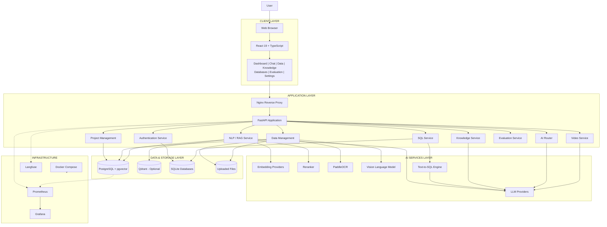

---

# 2. Application Components

## 2.1 Frontend Architecture

**Technology:** React 19, Vite, TypeScript, Tailwind CSS.

The frontend communicates with the backend through HTTP APIs.

```mermaid
flowchart TB
    APP["React Application"]

    APP --> AUTH["Authentication"]
    APP --> DASH["Dashboard"]
    APP --> CHAT["Chat Interface"]
    APP --> DATA["Data Management"]
    APP --> KNOW["Knowledge"]
    APP --> VIDEO["Video"]
    APP --> DB["Database Management"]
    APP --> EVAL["Evaluation"]
    APP --> SETTINGS["Settings / Admin"]

    AUTH --> LOGIN["Login / Register"]
    AUTH --> VERIFY["Email Verification"]
    AUTH --> RESET["Password Recovery"]

    CHAT --> RAG["RAG Chat"]
    CHAT --> MULTI["Multimodal Chat"]
    CHAT --> EXCEL["Excel-to-SQL"]
    CHAT --> SQL["Database Query"]

    DATA --> UPLOAD["File Upload"]
    DATA --> PROCESS["Document Processing"]
    DATA --> INDEX["Vector Indexing"]

    KNOW --> TASKS["Summary / Key Points / Notes"]
    KNOW --> FLASH["Flashcards / Quiz"]
    KNOW --> FAQ["FAQ / Mindmap / Q&A"]

    DB --> CONNECTION["Connection Management"]
    DB --> QUERY["Natural Language SQL"]

    EVAL --> RAGAS["RAGAS Dashboard"]
    EVAL --> SQLEVAL["SQL Evaluation"]
```

### Frontend Modules

| Module | Responsibility |
|---|---|
| Authentication | Login, registration, verification, password recovery |
| Dashboard | Projects and system overview |
| Chat | RAG, multimodal, Excel and database conversations |
| Data | Upload, process and index documents |
| Knowledge | Document summarization and knowledge extraction |
| Video | YouTube ingestion |
| Databases | External database connection management |
| Evaluation | RAGAS and SQL evaluation |
| Settings | Application settings and user management |
| i18n | Arabic / English and RTL support |

### Frontend Technologies

| Component | Technology |
|---|---|
| Framework | React 19 |
| Build Tool | Vite |
| Language | TypeScript |
| Styling | Tailwind CSS |
| Routing | React Router |
| Data Fetching | TanStack Query |
| Icons | Lucide React |
| Markdown | React Markdown |
| Internationalization | Custom Arabic / English implementation |

---

# 3. Backend Architecture

**Framework:** FastAPI + Python 3.11

The backend follows a layered architecture:

- Routes: HTTP endpoints and request handling.
- Controllers: Application logic and orchestration.
- Services: Specialized business operations.
- Stores: AI providers, vector databases, SQL providers and integrations.
- Models: Database models and schemas.
- Helpers: Shared utilities and configuration.

## 3.1 Backend Architecture Diagram

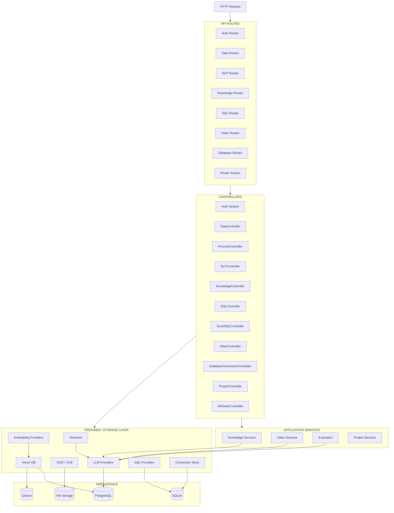

## 3.2 API Modules

| Endpoint | Module | Responsibility |
|---|---|---|
| `/api/v1/auth/*` | Authentication | User authentication and account management |
| `/api/v1/data/*` | Data | Upload, processing, indexing and reset |
| `/api/v1/nlp/*` | NLP | RAG retrieval and generation |
| `/api/v1/knowledge/*` | Knowledge | Knowledge extraction tasks |
| `/api/v1/video/*` | Video | YouTube ingestion |
| `/api/v1/databases/*` | Databases | External database connections |
| `/api/v1/router/*` | AI Router | Intent classification and routing |
| `/sql/*` | SQL | SQL generation, execution and evaluation |
| `/api/v1/` | Health | Application health and version |

## 3.3 Controllers

| Controller | Responsibility |
|---|---|
| `AIRouterController` | Classifies user intent and routes requests |
| `NLPController` | RAG retrieval, reranking and answer generation |
| `KnowledgeController` | Executes knowledge extraction tasks |
| `SQLController` | Generates, validates and executes SQL |
| `ExcelSQLController` | Converts Excel files into queryable SQLite databases |
| `ProcessController` | Processes PDFs, images, Excel and text files |
| `DataController` | Handles file uploads and validation |
| `ProjectController` | Manages project directories and project operations |
| `VideoController` | Handles YouTube ingestion |
| `DatabaseConnectionController` | Manages external database connections |

---

# 4. AI Services Architecture

The AI layer is provider-based, allowing different models and services to be used without tightly coupling the application to one vendor.

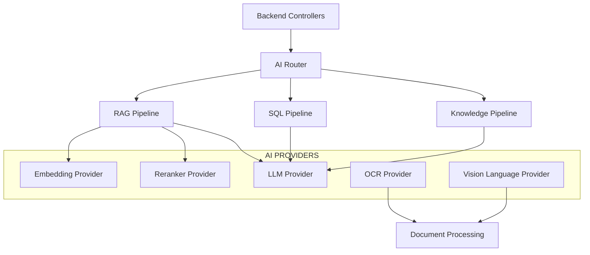

## 4.1 LLM Providers

Responsible for text generation and reasoning.

Supported integrations:

- OpenAI-compatible API
- OpenAI
- Cohere
- HuggingFace
- Ollama-compatible local inference

## 4.2 Embedding Providers

Convert text into numerical vector representations for semantic retrieval.

Supported integrations:

- OpenAI Embeddings
- HuggingFace Sentence Transformers

## 4.3 Reranking

The reranker evaluates retrieved chunks against the original query and improves context selection.

Model:

`BAAI/bge-reranker-v2-m3`

## 4.4 OCR

PaddleOCR provides text extraction from images and scanned documents.

Supported languages:

- Arabic
- English

## 4.5 Vision Language Model

Ollama provides local VLM inference for image understanding.

Example model:

`qwen2.5vl:3b`

---

# 5. Data Processing Architecture

## 5.1 Supported Input Types

| Input | Processing |
|---|---|
| PDF | PyMuPDF + OCR / VLM |
| Images | OCR + VLM |
| Excel | OpenPyXL |
| TXT | Direct text extraction |
| YouTube | Video ingestion pipeline |

## 5.2 Document Ingestion Pipeline

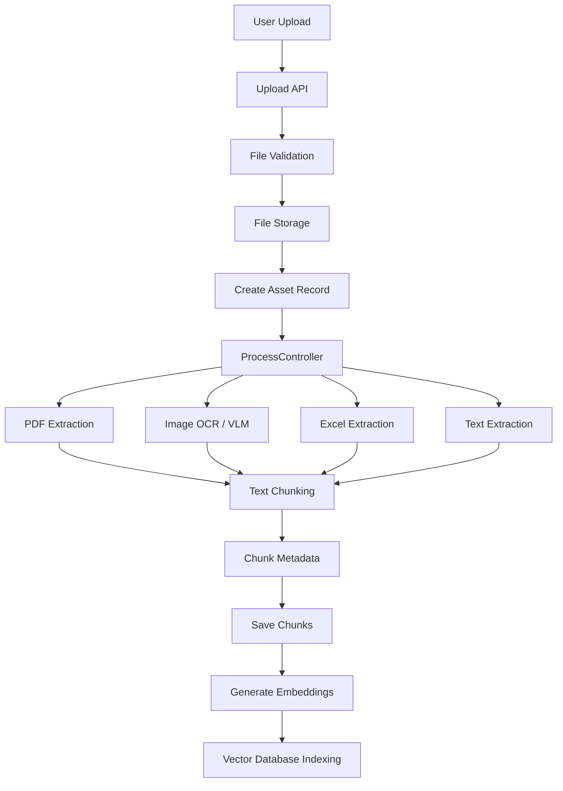

### Processing Stages

1. Upload and validate the input file.
2. Store the original file.
3. Create an asset record.
4. Extract text or visual information.
5. Split extracted content into chunks.
6. Attach metadata to each chunk.
7. Persist chunks in PostgreSQL.
8. Generate embeddings.
9. Insert vectors into the configured vector database.

---

# 6. RAG Architecture

The RAG pipeline combines semantic retrieval, neighboring chunk expansion, reranking and grounded generation.

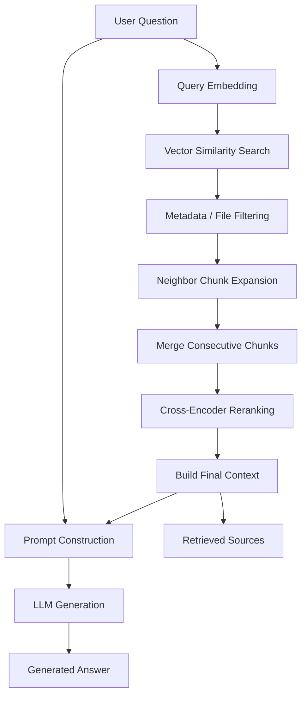

### RAG Components

| Component | Responsibility |
|---|---|
| Query Embedding | Converts the question into a vector |
| Vector Search | Retrieves semantically relevant chunks |
| Metadata Filtering | Filters by project and selected files |
| Neighbor Expansion | Retrieves adjacent chunks |
| Chunk Merging | Combines consecutive content |
| Reranker | Reorders retrieved contexts |
| Prompt Builder | Constructs the grounded generation prompt |
| LLM | Generates the final response |

---

# 7. SQL Architecture

The system supports natural-language database querying and Excel-to-SQL.

## 7.1 Natural Language to SQL

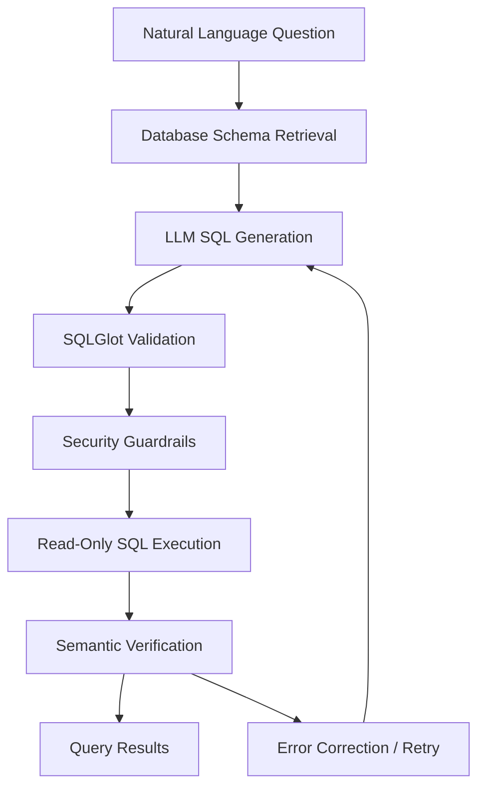

### SQL Security Controls

- SELECT-only query validation.
- SQL parsing using SQLGlot.
- Table and column allowlisting.
- Maximum result row limits.
- Read-only execution.
- Query retry limits.
- Optional semantic verification.

## 7.2 Excel-to-SQL

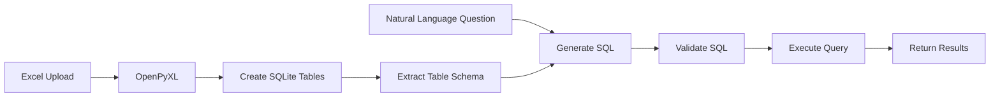

Each project can have its own Excel-generated SQLite database.

---

# 8. AI Router Architecture

The AI Router identifies the user's intent and directs the request to the appropriate subsystem.

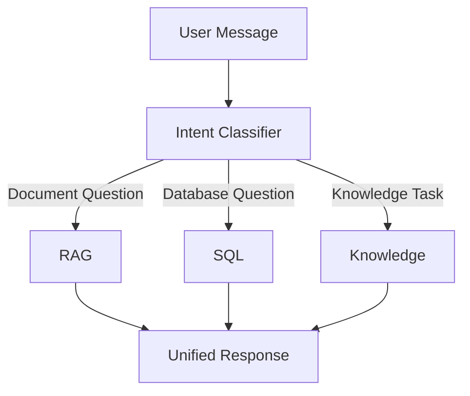

Supported routing categories:

- RAG
- SQL
- Knowledge

---

# 9. Database Architecture

The system uses multiple storage technologies, each serving a specific responsibility.

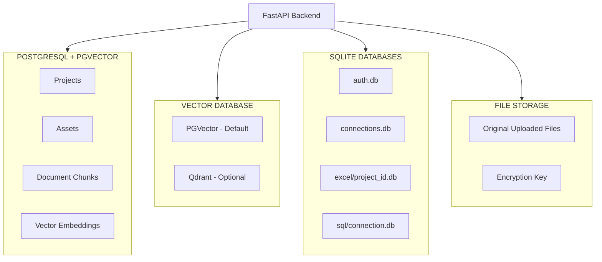

## 9.1 PostgreSQL + pgvector

Primary relational database.

Stores:

- Projects
- Assets
- Document chunks
- Related metadata
- Vector embeddings when PGVector is selected

## 9.2 Vector Database

Supported backends:

| Backend | Purpose |
|---|---|
| PGVector | Default vector storage and retrieval |
| Qdrant | Optional vector database backend |

## 9.3 SQLite

Used for isolated application and query storage.

| Database | Purpose |
|---|---|
| `auth.db` | Authentication and user records |
| `connections.db` | Saved external database connections |
| `excel/project_{id}.db` | Excel-generated project databases |
| `sql/{connection}.db` | Local SQL database files |

## 9.4 File Storage

Original uploaded documents are stored under:

`src/assets/files/{project_id}/`

Database runtime files are stored under:

`src/assets/database/`

---

# 10. Authentication & Security Architecture

The authentication system is implemented independently from the main RAG processing pipeline.

## 10.1 Authentication Flow

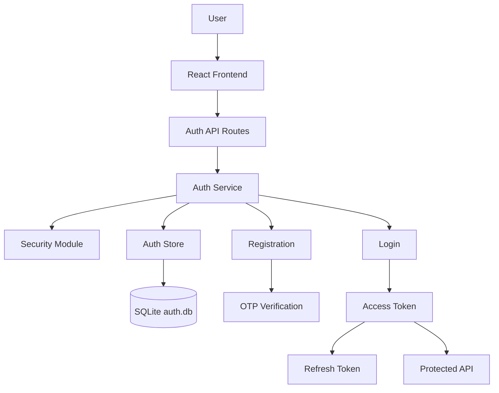

## 10.2 Authentication Features

| Feature | Implementation |
|---|---|
| Access Tokens | JWT HS256 |
| Refresh Tokens | Rotating refresh tokens |
| Password Hashing | Argon2id |
| OTP | Six-digit verification code |
| OTP Storage | HMAC-based hashing |
| OTP Expiration | Configurable TTL |
| Rate Limiting | IP-based rate limiting |
| Account Lockout | Temporary lock after repeated failures |
| Roles | User / Admin |
| Token Revocation | Token versioning and refresh-token family revocation |

## 10.3 Token Lifecycle

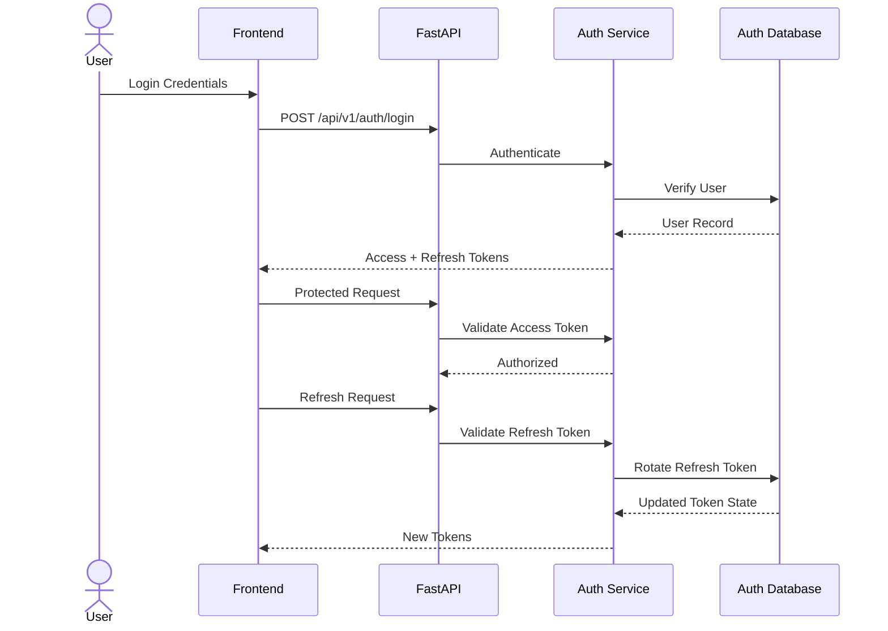

## 10.4 Additional Security

- Password hashing with Argon2id.
- Encrypted external connection credentials using Fernet.
- SQL query validation and read-only execution.
- Authentication rate limiting.
- Refresh-token reuse detection.
- Role-based access control.
- Environment-based secret management.

External database credentials are encrypted before being persisted in the connections store.

---

# 11. Docker & Infrastructure Architecture

Docker Compose manages the containerized application infrastructure.

## 11.1 Infrastructure Diagram

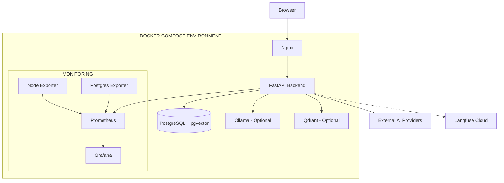

**Note:** Optional services are enabled only when configured in Docker Compose. Langfuse Cloud is an external service, not a local Docker container.

## 11.2 Infrastructure Services

| Service | Technology | Responsibility |
|---|---|---|
| Frontend | React / Nginx | User interface |
| Backend | FastAPI | API and application logic |
| Database | PostgreSQL 16 | Relational persistence |
| Vector Extension | pgvector | Vector similarity search |
| Vector DB | Qdrant | Optional vector storage |
| Local AI | Ollama | Local LLM / VLM inference |
| Reverse Proxy | Nginx | HTTP routing and static frontend |
| Metrics | Prometheus | Metrics collection |
| Dashboards | Grafana | Monitoring visualization |
| Host Monitoring | Node Exporter | System metrics |
| Database Monitoring | Postgres Exporter | PostgreSQL metrics |
| LLM Monitoring | Langfuse Cloud | LLM tracing and observability |

## 11.3 Docker Directory

```text
docker/
│
├── docker-compose.yml
│
├── env/
│   ├── .env.app
│   ├── .env.postgres
│   ├── .env.grafana
│   └── .env.postgres-exporter
│
├── nginx/
│   └── default.conf
│
├── prometheus/
│   └── prometheus.yml
│
└── rag/
    ├── Dockerfile
    ├── entrypoint.sh
    └── alembic.ini
```

## 11.4 Docker Networking

The application uses Docker networks to separate application communication from external access.

Typical communication:

- Nginx → Backend
- Backend → PostgreSQL
- Backend → Ollama (if containerized)
- Backend → Qdrant (if enabled)
- Prometheus → Backend metrics
- Prometheus → Exporters
- Grafana → Prometheus

Persistent Docker volumes are used for database data and other configured persistent services.

---

# 12. Observability & Monitoring

The platform integrates infrastructure monitoring and LLM tracing.

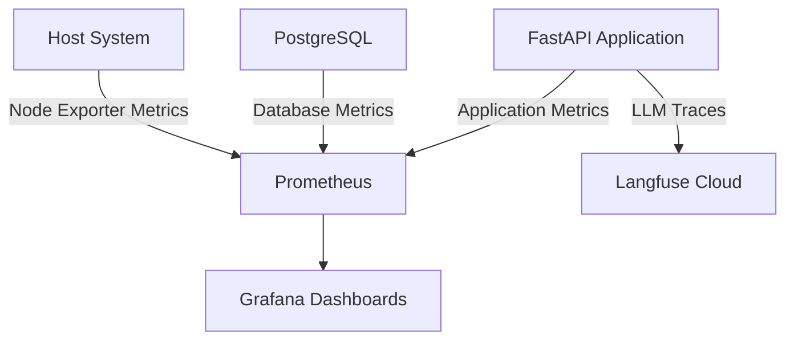

## 12.1 Prometheus

Collects:

- FastAPI metrics
- PostgreSQL metrics
- Host CPU and memory metrics
- Infrastructure metrics

## 12.2 Grafana

Provides monitoring dashboards and visualization using Prometheus as a data source.

## 12.3 Langfuse

Provides LLM observability:

- LLM traces
- Generation calls
- Request tracking
- Prompt and response observability

---

# 13. Evaluation Architecture

The system includes two independent evaluation pipelines.

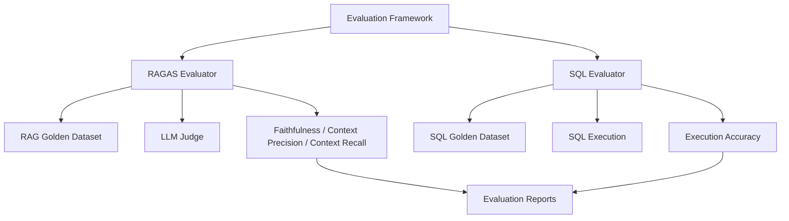

## 13.1 RAGAS Evaluation

Evaluates RAG answer quality using:

| Metric | Purpose |
|---|---|
| Faithfulness | Measures whether the answer is grounded in retrieved context |
| Context Precision | Measures relevance of retrieved context |
| Context Recall | Measures coverage of the reference answer |

Dataset:

`src/evaluation/datasets/rag_egyptian_civil_code_60.json`

## 13.2 SQL Evaluation

Evaluates generated SQL through execution-based comparison.

Supported evaluation categories:

- Excel-to-SQL
- Connected database queries

Metric:

**Execution Accuracy:** Result-set equality between generated SQL output and expected output.

Datasets:

- `sql_excel_test_60.json`
- `sql_sakila_60.json`

Evaluation reports are generated under:

`src/evaluation/results/`

---

# 14. Repository Structure

```text
Rag-system/
│
├── src/
│   │
│   ├── auth/
│   │   ├── config.py
│   │   ├── dependencies.py
│   │   ├── errors.py
│   │   ├── ratelimit.py
│   │   ├── routes.py
│   │   ├── schemas.py
│   │   ├── security.py
│   │   ├── senders.py
│   │   ├── service.py
│   │   └── store.py
│   │
│   ├── controllers/
│   │   ├── AIRouterController.py
│   │   ├── BaseController.py
│   │   ├── DatabaseConnectionController.py
│   │   ├── DataController.py
│   │   ├── ExcelSQLController.py
│   │   ├── KnowledgeController.py
│   │   ├── NLPController.py
│   │   ├── ProcessController.py
│   │   ├── ProjectController.py
│   │   ├── SQLController.py
│   │   └── VideoController.py
│   │
│   ├── helpers/
│   │   ├── config.py
│   │   ├── file_utils.py
│   │   └── sql_access.py
│   │
│   ├── models/
│   │   ├── AssetModel.py
│   │   ├── ChunkModel.py
│   │   ├── ProjectModel.py
│   │   ├── SQLModel.py
│   │   ├── VideoModel.py
│   │   └── db_schemes/
│   │       └── ragsystem/
│   │
│   ├── routes/
│   │   ├── base.py
│   │   ├── data.py
│   │   ├── databases.py
│   │   ├── knowledge.py
│   │   ├── nlp.py
│   │   ├── router.py
│   │   ├── sql.py
│   │   ├── video.py
│   │   └── schemes/
│   │
│   ├── services/
│   │   ├── knowledge/
│   │   └── video/
│   │
│   ├── stores/
│   │   ├── llm/
│   │   ├── ocr/
│   │   ├── reranker/
│   │   ├── router/
│   │   ├── sql/
│   │   ├── vectordb/
│   │   └── vlm/
│   │
│   ├── evaluation/
│   │   ├── datasets/
│   │   ├── results/
│   │   ├── ragas_evaluator.py
│   │   └── sql_evaluator.py
│   │
│   ├── assets/
│   │   ├── files/
│   │   └── database/
│   │       ├── auth.db
│   │       ├── connections.db
│   │       ├── .connections.key
│   │       ├── excel/
│   │       └── sql/
│   │
│   ├── main.py
│   ├── requirements.txt
│   └── .env
│
├── frontend/
│   ├── src/
│   │   ├── components/
│   │   ├── hooks/
│   │   ├── i18n/
│   │   ├── lib/
│   │   ├── pages/
│   │   ├── App.tsx
│   │   ├── main.tsx
│   │   └── index.css
│   │
│   ├── package.json
│   ├── vite.config.ts
│   ├── tailwind.config.js
│   ├── tsconfig.json
│   └── nginx.conf
│
├── docker/
│   ├── docker-compose.yml
│   ├── env/
│   ├── nginx/
│   ├── prometheus/
│   └── rag/
│
└── README.md
```

---

# 15. Development Setup

## 15.1 Prerequisites

| Dependency | Version |
|---|---|
| Python | 3.11+ |
| Node.js | 20.19+ / 22+ |
| PostgreSQL | 16+ |
| Docker | Docker Engine |
| Docker Compose | Compose Plugin |
| Ollama | Optional |
| Conda | Recommended |

## 15.2 Backend Installation

```bash
git clone <repository-url>

cd Rag-system/src

conda create -n mini-rag-app python=3.11 -y

conda activate mini-rag-app

pip install -r requirements.txt
```

## 15.3 Environment Configuration

Create the backend environment file:

```bash
cp .env.example .env
```

Configure the following variables:

```env
APP_NAME=mini-RAG
APP_VERSION=0.1

# PostgreSQL
POSTGRES_USERNAME=postgres
POSTGRES_PASSWORD=CHANGE_ME
POSTGRES_HOST=localhost
POSTGRES_PORT=5432
POSTGRES_MAIN_DATABASE=ragsystem

# LLM
GENERATION_BACKEND=OPENAI
GENERATION_MODEL_ID=gpt-4o-mini
OPENAI_API_KEY=YOUR_API_KEY

# Embeddings
EMBEDDING_BACKEND=OPENAI
EMBEDDING_MODEL_ID=text-embedding-3-small
EMBEDDING_MODEL_SIZE=1536

# Vector Database
VECTOR_DB_BACKEND=PGVECTOR
VECTOR_DB_DISTANCE_METHOD=cosine
VECTOR_DB_PGVEC_INDEX_THRESHLOD=300

# Reranker
RERANKER_PROVIDER=huggingface
RERANKER_MODEL_ID=BAAI/bge-reranker-v2-m3
RERANK_ENABLED=true
FINAL_CONTEXTS=5
NEIGHBOR_WINDOW=1
NEIGHBOR_MIN_RERANK=0.5

# SQL
SQL_PROVIDER=sqlite
SQL_DATABASE_URL=sqlite:///assets/database/sql/ecommerce.db
SQL_MAX_ROWS=100
SQL_MAX_RETRIES=2

# Authentication
AUTH_ENABLED=true
AUTH_DATABASE_URL=sqlite:///assets/database/auth.db
JWT_SECRET_KEY=GENERATE_A_SECURE_SECRET
AUTH_ADMIN_IDENTIFIERS=admin@example.com
AUTH_EMAIL_DELIVERY=console

# External Connections
CONNECTIONS_DB_PATH=assets/database/connections.db
CONNECTIONS_SECRET_KEY=GENERATE_FERNET_KEY
CONNECTIONS_ALLOW_PRIVATE_HOSTS=true
SQLITE_CONNECT_DIR=assets/database/sql

# Langfuse
LANGFUSE_PUBLIC_KEY=
LANGFUSE_SECRET_KEY=
LANGFUSE_BASE_URL=https://cloud.langfuse.com
```

Generate secure secrets:

```bash
python -c "import secrets; print(secrets.token_urlsafe(64))"
```

Generate a Fernet key:

```bash
python -c "from cryptography.fernet import Fernet; print(Fernet.generate_key().decode())"
```

Use your actual application configuration and keep secrets outside version control.

## 15.4 Start PostgreSQL

```bash
cd ../docker

docker compose up -d pgvector
```

## 15.5 Database Migrations

```bash
cd ../src/models/db_schemes/ragsystem

alembic upgrade head
```

## 15.6 Start Backend

```bash
cd ~/Desktop/Rag-system/Rag-system/src

uvicorn main:app --reload --host 0.0.0.0 --port 5001
```

Backend API:

`http://localhost:5001`

Swagger:

`http://localhost:5001/docs`

## 15.7 Frontend Installation

Open another terminal:

```bash
cd ~/Desktop/Rag-system/Rag-system/frontend

npm install
```

Configure the backend URL:

```env
VITE_BACKEND_URL=http://localhost:5001
```

Start the frontend:

```bash
npm run dev
```

Frontend:

`http://localhost:5173`

---

# 16. Ollama Configuration

Ollama can be used for local LLM and VLM inference.

Start Ollama:

```bash
ollama serve
```

Pull models:

```bash
ollama pull qwen2.5vl:3b
```

For OpenAI-compatible local generation:

```env
GENERATION_BACKEND=OPENAI
GENERATION_MODEL_ID=qwen2.5:7b-instruct
OPENAI_API_KEY=ollama
OPENAI_API_URL=http://localhost:11434/v1/
```

The VLM provider is configured separately for image understanding.

---

# 17. Production Deployment

Build the frontend:

```bash
cd ~/Desktop/Rag-system/Rag-system/frontend

npm install
npm run build
```

Build and start the Docker environment:

```bash
cd ../docker

docker compose up -d --build
```

Check running services:

```bash
docker compose ps
```

View logs:

```bash
docker compose logs -f
```

Stop services:

```bash
docker compose down
```

Remove containers and persistent volumes:

```bash
docker compose down -v
```

**Warning:** Removing volumes can permanently delete database data.

---

# 18. Monitoring Endpoints

| Service | Endpoint |
|---|---|
| Frontend | `http://localhost` |
| Backend | `http://localhost:5001` |
| Swagger | `http://localhost:5001/docs` |
| Ollama | `http://localhost:11434` |
| Prometheus | `http://localhost:9090` |
| Grafana | `http://localhost:3000` |
| Qdrant Dashboard | `http://localhost:6333/dashboard` |

Actual exposed ports depend on Docker Compose configuration.

---

# 19. Evaluation Commands

## RAGAS

```bash
cd ~/Desktop/Rag-system/Rag-system/src

PYTHONPATH=. python evaluation/ragas_evaluator.py \
  --json evaluation/datasets/rag_egyptian_civil_code_60.json \
  --file-id "<asset_name>" \
  --tag civil_code
```

## SQL Evaluation — Excel

```bash
PYTHONPATH=. python evaluation/sql_evaluator.py \
  --questions evaluation/datasets/sql_excel_test_60.json \
  --mode excel \
  --tag excel
```

## SQL Evaluation — Connected Database

```bash
PYTHONPATH=. python evaluation/sql_evaluator.py \
  --questions evaluation/datasets/sql_sakila_60.json \
  --mode database \
  --db "conn://<connection_id>" \
  --tag sakila
```

Evaluation reports are saved under:

```text
src/evaluation/results/
```

---

# 20. Configuration Reference

| Category | Environment Variables |
|---|---|
| Application | `APP_NAME`, `APP_VERSION` |
| PostgreSQL | `POSTGRES_*` |
| Generation | `GENERATION_BACKEND`, `GENERATION_MODEL_ID` |
| OpenAI | `OPENAI_API_KEY`, `OPENAI_API_URL` |
| Embeddings | `EMBEDDING_BACKEND`, `EMBEDDING_MODEL_ID`, `EMBEDDING_MODEL_SIZE` |
| Vector DB | `VECTOR_DB_BACKEND`, `VECTOR_DB_DISTANCE_METHOD` |
| Reranking | `RERANKER_PROVIDER`, `RERANKER_MODEL_ID`, `RERANK_ENABLED` |
| Retrieval | `FINAL_CONTEXTS`, `NEIGHBOR_WINDOW`, `NEIGHBOR_MIN_RERANK` |
| SQL | `SQL_PROVIDER`, `SQL_DATABASE_URL`, `SQL_MAX_ROWS`, `SQL_MAX_RETRIES` |
| SQL Security | `SQL_SEMANTIC_VERIFY`, `SQL_SCHEMA_CACHE_TTL` |
| Authentication | `AUTH_ENABLED`, `AUTH_DATABASE_URL`, `JWT_SECRET_KEY` |
| Email | `AUTH_EMAIL_DELIVERY`, `SMTP_*` |
| SMS | `AUTH_SMS_DELIVERY`, `TWILIO_*` |
| Connections | `CONNECTIONS_DB_PATH`, `CONNECTIONS_SECRET_KEY` |
| Observability | `LANGFUSE_PUBLIC_KEY`, `LANGFUSE_SECRET_KEY`, `LANGFUSE_BASE_URL` |
| Internationalization | `PRIMARY_LANG`, `DEFAULT_LANG` |

Refer to the application's configuration implementation for the complete list of supported options and defaults.

---

# 21. License

Internal Project — All Rights Reserved.